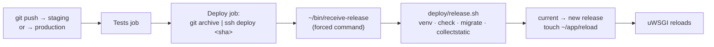

# Deployment

| Environment | URLs | Runs | Database | Uploads | Deploys |
| --- | --- | --- | --- | --- | --- |
| Local | http://localhost:8000 (EN), http://127.0.0.1:8000 (PT-BR) | `manage.py runserver` | SQLite (`db.sqlite3`) | `media/` | — |
| Staging | https://staging.lavedonio.com (EN), https://staging.lavedonio.com.br (PT-BR) | Django under uWSGI on the CloudPanel VPS: Python site `staging.lavedonio.com` (site user `lavedonio-staging`, app port 8091), plus the reverse-proxy site `staging.lavedonio.com.br` (site user `lavedonio-staging-br`) in front of the same uWSGI | Schema `lavedonio_staging` | R2 bucket `lavedonio-staging`, at https://media-staging.lavedonio.com | Every push to the `staging` branch ([workflow](../.github/workflows/deploy-staging.yml)) |
| Production | https://lavedonio.com (EN), https://lavedonio.com.br (PT-BR); their `www.` hosts redirect to them | Same layout: Python site `lavedonio.com` (site user `lavedonio`, app port 8092), plus the reverse-proxy site `lavedonio.com.br` (site user `lavedonio-br`) | Schema `lavedonio_production` | R2 bucket `lavedonio`, at https://media.lavedonio.com | Every push to the `production` branch, once approved ([workflow](../.github/workflows/deploy-production.yml)) |

The server addresses aren't in this repository, which is public: the sites are
behind Cloudflare's proxy, which keeps the origin server's address hidden. They
are in the private infrastructure notes (`personal_terraform`) and in the deploy
workflows' secrets.

- **CloudPanel VPS** (Hostinger): nginx, uWSGI and the sites.
- **Data VPS** (Hostinger): PostgreSQL 18 in Docker, managed by Terraform
  (`personal_terraform`, module `data-platform`). Only the CloudPanel and n8n
  VPSs can reach it, and only over TLS.
- **Cloudflare**: DNS and CDN of both domains (proxied records), R2 for uploads,
  and Turnstile for the contact form.
- **Google Workspace**: the domains' e-mail, and the SMTP relay production's
  contact form sends through.

Until 2026-10-20, production was the v1 site, on Heroku. v1's post URLs
(`/blog/post/<slug>/`) redirect to the posts; its other Portuguese paths
(`/projetos/...`, `/sobre/`, `/contato/`) are the same in v2.

## How a deploy works



1. [`deploy-staging.yml`](../.github/workflows/deploy-staging.yml) and
   [`deploy-production.yml`](../.github/workflows/deploy-production.yml) run the
   tests ([`tests.yml`](../.github/workflows/tests.yml), which also runs on pull
   requests), then stream `git archive HEAD` over SSH as the environment's site
   user (`lavedonio-staging` or `lavedonio`).
2. The deploy key in that user's `authorized_keys` is
   `restrict,command="~/bin/receive-release"`: it can't open a shell or a tunnel,
   only hand over a tarball. [`receive-release.sh`](receive-release.sh) unpacks
   it into `~/app/releases/<time>-<sha>/` and runs that release's
   [`release.sh`](release.sh).
3. `release.sh` builds a fresh `.venv` with `/usr/bin/python3.12`, runs
   `check --deploy`, `migrate`, `createcachetable` and `collectstatic`, then
   points `~/app/current` at the new release and touches `~/app/reload`. uWSGI's
   `touch-reload` re-execs it from the new release. If any step before the
   switch fails, visitors keep the old release. If the site doesn't answer after
   the switch, `current` goes back to the previous release (migrations are not
   reverted). The last 5 releases are kept.
4. The workflow then checks the public URLs (production's `www.` hosts too).

Production also:

- only deploys commits that are on `main` (the `on-main` job): deploy with
  `git push origin main:production`;
- waits for a required reviewer (Lavedonio) to approve the deploy job in the
  Actions tab, as the `lavedonio` environment asks. Admins can't skip it.

Each workflow uses its own environment's secrets, which only its branch can use:

| Secret (staging / production) | What |
| --- | --- |
| `STAGING_DEPLOY_SSH_KEY` / `PROD_DEPLOY_SSH_KEY` | Private deploy key (its public half is in the site user's `authorized_keys`) |
| `STAGING_SSH_HOST` / `PROD_SSH_HOST` | The CloudPanel VPS's address, alone, so GitHub masks it wherever it appears in the (public) logs |
| `STAGING_SSH_KNOWN_HOSTS` / `PROD_SSH_KNOWN_HOSTS` | The CloudPanel VPS's SSH host keys, pinned (from `/etc/ssh/ssh_host_*_key.pub`, checked against `ssh-keyscan`) |

| Environment (GitHub) | Branch | Protection |
| --- | --- | --- |
| `lavedonio-staging` | `staging` | — |
| `lavedonio` | `production` | Required reviewer, no admin bypass |

Layout on the server, for each site user (`lavedonio-staging`, `lavedonio`):

```
/home/<site user>/
  app/
    releases/<time>-<sha>/      code, .venv, staticfiles, REVISION, .env → shared/.env
    current → releases/...      what uWSGI runs
    shared/.env                 settings and secrets (0600)
    shared/postgres-ca.pem      the data VPS's Postgres certificate
    reload                      touched by each deploy
  bin/receive-release
  htdocs/<domain>/
    static → ~/app/current/staticfiles   served by nginx
/etc/uwsgi/apps-enabled/<site user>.ini   from deploy/uwsgi.ini (root-owned)
/var/log/uwsgi/app/<site user>.log
```

CloudPanel's Python vhost proxies every request to the app port, where uWSGI
listens (`http-socket`), except files with a static extension (css, js, svg,
png...), which nginx serves from the document root, hence the `static` symlink.
The `.com.br` site is a reverse-proxy site to the same port, so it passes
everything to uWSGI and static files come from Django (WhiteNoise).
Static file names carry a hash of their content (`collectstatic` with
WhiteNoise's manifest storage), so Cloudflare and browsers can keep them for good.

Django answers both hosts (`ALLOWED_HOSTS` in `StagingSettings` and
`ProductionSettings`, in `env_settings.py`) and picks the language from the
host. Uploads are in R2, so the server has no `media` folder. Posts and projects
keep `/media/...` links (like the ones imported from v1): the `media_urls`
template filter points them to the bucket's domain when the page is rendered,
because on the Python site nginx answers image URLs itself and they would never
reach Django. Other `/media/...` requests that do reach Django redirect to the
bucket.

Staging sends `X-Robots-Tag: noindex` and a `Disallow: /` robots.txt, its HSTS
lasts an hour, and the contact form's e-mails are only written to the uWSGI log.
Production's HSTS lasts a year, and its contact form sends e-mails through
Google Workspace's SMTP relay (`smtp-relay.gmail.com`), which accepts them
because they come from the CloudPanel VPS's address (no SMTP password; it
connects over IPv6), from `DEFAULT_FROM_EMAIL` to `CONTACT_EMAIL`.

## Everyday operations

Root commands use the key `personal_terraform` uses for the VPSs
(`~/.ssh/id_ed25519_hostinger`); in the examples, `$CLOUDPANEL` is the CloudPanel
VPS's address, and `<site user>` is `lavedonio-staging` or `lavedonio`.

| To... | Do |
| --- | --- |
| Deploy a branch to staging | `git push origin <branch>:staging` (add `--force` to replace what staging has). Or re-run the workflow from the Actions tab. |
| Deploy to production | Merge into `main`, then `git push origin main:production`, and approve the deploy in the Actions tab |
| See what's live | `cat ~/app/current/REVISION` as the site user |
| Read the logs | `/var/log/uwsgi/app/<site user>.log` (Django warnings and errors, and staging's contact form e-mails) and `~/logs/nginx/` |
| Run a management command | as root: `runuser -u <site user> -- bash -c 'cd ~/app/current/site_lavedonio_django && ../.venv/bin/python manage.py <command>'` |
| Roll back | as root: `runuser -u <site user> -- bash -c 'cd ~/app && ln -sfn releases/<older> current && touch reload'`. Migrations aren't reverted. |
| Restart uWSGI | as root: `systemctl restart uwsgi` (restarts every uWSGI app on the VPS, including other projects') |
| Start or stop only one app | as root: `env -i PATH=/usr/sbin:/usr/bin:/sbin:/bin SYSTEMCTL_SKIP_REDIRECT=1 /etc/init.d/uwsgi start <site user>` (or `stop`). `env -i` gives it the clean environment systemd would: with root's `HOME`, libpq tries to read `/root/.postgresql` and every request fails. |
| Change a setting | edit `~/app/shared/.env` as the site user, then `touch ~/app/reload` (uWSGI loads Django only in its workers, so a reload reads it again) |

Interactive commands need `ssh -t`. For example, to edit production's settings,
or to create an admin user:

```bash
ssh -t -i ~/.ssh/id_ed25519_hostinger root@$CLOUDPANEL "runuser -u lavedonio -- nano /home/lavedonio/app/shared/.env"
ssh -t -i ~/.ssh/id_ed25519_hostinger root@$CLOUDPANEL \
  "runuser -u lavedonio -- bash -c 'cd ~/app/current/site_lavedonio_django && ../.venv/bin/python manage.py createsuperuser'"
```

To fill staging with fake posts and projects (they're tagged so they can be
removed), run the `create_demo_content` command, or `create_demo_content --delete`
to remove them. It refuses to run in production.

## Database

Each environment has a role and a schema of the same name in
`lavedonio_postgres`, owned by that role, with the role's `search_path` set to
it. Django also sets it (`DB_SCHEMA`). The roles can't see each other's schema.

| Role / schema | Login | Used by |
| --- | --- | --- |
| `lavedonio_staging` | yes (password in staging's `.env`) | staging |
| `lavedonio_production` | yes (password in production's `.env`) | production |

They're created by hand (not by Terraform), as superuser on the data VPS
(`cd /opt/data-platform && docker compose exec postgres psql -U postgres -d lavedonio_postgres`):

```sql
CREATE ROLE lavedonio_staging LOGIN PASSWORD '...' CONNECTION LIMIT 20;
CREATE SCHEMA lavedonio_staging AUTHORIZATION lavedonio_staging;
ALTER ROLE lavedonio_staging IN DATABASE lavedonio_postgres SET search_path = lavedonio_staging;
```

The password can also be given as its SCRAM-SHA-256 verifier
(`'SCRAM-SHA-256$4096:...'`, what Postgres stores), so the password itself never
reaches the data VPS; production's was set that way, and generated straight into
its `.env`.

Django connects with `sslmode=verify-full` against the data VPS's self-signed
certificate (`shared/postgres-ca.pem`). Terraform rotates it within 30 days of
expiry; copy the new one to each site afterwards (`scripts/tf data output -raw
db_tls_certificate_pem` in `personal_terraform`).

Metabase's `metabase_reader` can read every schema of the server
(`pg_read_all_data`), including `auth_user`. The nightly backup of the data VPS
covers these schemas too.

## Uploads (Cloudflare R2)

Each environment has its own bucket, public only through its custom domain
(served and cached by Cloudflare's CDN): `lavedonio-staging` at
`media-staging.lavedonio.com` and `lavedonio` at `media.lavedonio.com`. Django
writes to it through R2's S3 API (django-storages), with an R2 API token limited
to that bucket (*Object Read & Write*), whose key is in the `.env`
(`R2_ACCESS_KEY_ID`, `R2_SECRET_ACCESS_KEY`). If the token is limited to some
client IPs, include the CloudPanel VPS's IPv6 address as well as its IPv4 one:
the VPS reaches Cloudflare over IPv6, and R2 answers `AccessDenied` otherwise. Uploaded files never replace one
with the same name and are sent with a one-year `Cache-Control`.

The custom domains are one level below the zones (`media-staging`, not
`media.staging`), so Cloudflare's free certificate (`*.lavedonio.com`) covers them.

Files copied into a bucket by hand should go through Django's storage (e.g. a
`manage.py shell` script calling `default_storage.save`), not through the
Cloudflare dashboard or CLI, which don't set the `Cache-Control`.

## DNS and certificates

Both zones, `lavedonio.com` and `lavedonio.com.br`, are on Cloudflare with
*SSL/TLS → Overview* set to **Full (strict)**: Cloudflare validates the server's
certificate. Never use *Flexible*: Cloudflare would then talk to the server over
plain HTTP, and CloudPanel redirects that back to HTTPS forever. These are
proxied `A` records to the CloudPanel VPS, in each zone:

- `staging`: staging;
- the zone's apex and `www`: production.

A record that points at the VPS before CloudPanel has a site for it gets error
525 from Cloudflare, and 526 until the site has a valid certificate.

Each site has a Let's Encrypt certificate issued by CloudPanel, which renews them
daily through the proxy. For a site on a domain without subdomain
(`lavedonio.com`), CloudPanel also adds a vhost that redirects `www.<domain>` to
the domain, and puts `www.<domain>` in the certificate, so both records must
point at the VPS before the certificate is issued.

The **first** certificate of a new site can't be issued through the proxy
(Cloudflare rejects the self-signed certificate CloudPanel starts with), so
[`first-certificate.sh`](first-certificate.sh) serves the challenges (of the
domain and of its `www.`) over plain HTTP while it's issued:

```bash
tar -czf - deploy | ssh -i ~/.ssh/id_ed25519_hostinger root@$CLOUDPANEL \
  "d=\$(mktemp -d) && tar -xzf - -C \$d && bash \$d/deploy/first-certificate.sh \
   /home/lavedonio-staging/htdocs/staging.lavedonio.com staging.lavedonio.com; rm -rf \$d"
```

## Setting up an environment from scratch

Example values are staging's; production's are in the table at the top.

1. **DNS** (Cloudflare): proxied `A` records for `staging` in both zones, to the
   CloudPanel VPS (for production: the apex and `www` of both zones).
2. **CloudPanel sites** (as root on the VPS), then their certificates with
   `first-certificate.sh`:
   ```bash
   clpctl site:add:python --domainName=staging.lavedonio.com --pythonVersion=3.12 \
     --appPort=8091 --siteUser=lavedonio-staging --siteUserPassword="$(openssl rand -base64 30)"
   clpctl site:add:reverse-proxy --domainName=staging.lavedonio.com.br --reverseProxyUrl=http://127.0.0.1:8091 \
     --siteUser=lavedonio-staging-br --siteUserPassword="$(openssl rand -base64 30)"
   ```
3. **Database**: the role and schema (see *Database*).
4. **R2**: the bucket's custom domain, and an API token limited to it.
5. **Deploy key**: `ssh-keygen -t ed25519 -N '' -C 'github-actions deploy staging' -f deploy_key`.
   Store the private key and the other two secrets (see *How a deploy works*)
   in the environment in GitHub, then delete the private key locally.
6. **Server layout**, from the repo root:
   ```bash
   tar -czf - deploy | ssh -i ~/.ssh/id_ed25519_hostinger root@$CLOUDPANEL \
     "d=\$(mktemp -d) && tar -xzf - -C \$d && bash \$d/deploy/setup-server.sh lavedonio-staging \
      staging.lavedonio.com 8091 staging '$(cat deploy_key.pub)'; rm -rf \$d"
   ```
   [`setup-server.sh`](setup-server.sh) is safe to run again: it never
   overwrites `.env`.
7. **Secrets on the server**: fill in the empty values of `~/app/shared/.env`
   (database password and host, R2 key, Turnstile keys, and in production the
   e-mail addresses), and copy the database certificate to
   `~/app/shared/postgres-ca.pem`.
8. **First deploy**: push to the branch. It needs the R2 key (a migration copies
   the About page's pictures to the bucket), and stops at "does not answer"
   because uWSGI isn't running the app yet: start only that app (see *Everyday
   operations*), or run `systemctl restart uwsgi`, then re-run the workflow.

Production was set up this way on 2026-10-20, with its first release run by
hand (as root: `git archive` of the commit piped to
`runuser -u lavedonio -- env SSH_ORIGINAL_COMMAND='deploy <sha>' ~lavedonio/bin/receive-release`).
Its content was copied from the development database
(`dumpdata blog projects base uploads --natural-foreign`, then `loaddata` with
the posts' author changed to the production admin) and the development `media/`
files saved to the bucket through Django's storage.
